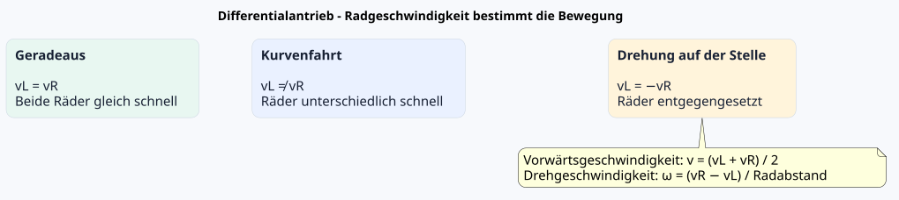
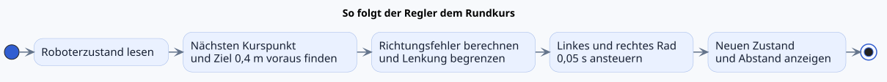
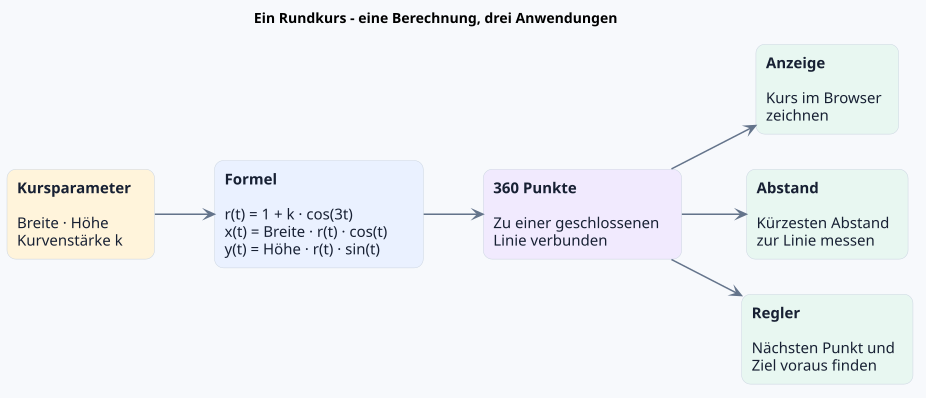
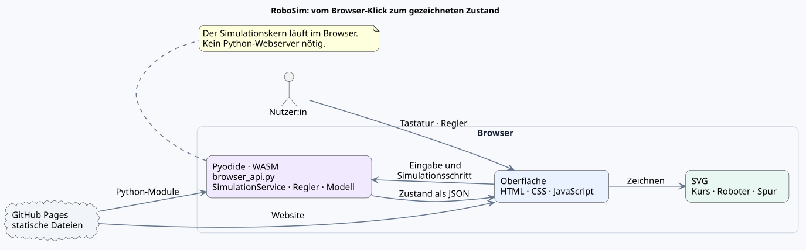

<!-- _class: lead -->

# RoboSim

## Einen Roboter simulieren und steuern

Ein Lernprojekt für Software Engineering und Regelungstechnik

---

# Die Projektidee

- Einen Roboter mit **zwei unabhängig angetriebenen Rädern** simulieren
- Seine Bewegung im Browser sichtbar machen
- Selbst steuern und mit einem automatischen Regler vergleichen
- Softwareentwicklung anhand eines greifbaren Beispiels kennenlernen

---

# Was kann RoboSim?

- **Manuell fahren:** mit W, A, S und D
- **Automatisch fahren:** ein Regler folgt einem Rundkurs
- **Kurs verändern:** Breite, Höhe und Kurvenstärke einstellen
- **Beobachten:** Roboter, Bewegungsverlauf und Abstand zur Linie

---

# Live-Demo

**Lokal mit NiceGUI**

```text
python -m src.web_demo
```

Danach `http://127.0.0.1:8093` öffnen.

**Auf GitHub Pages:** statische 2D-Oberfläche mit Pyodide; der Python-Kern
läuft direkt im Browser. Beide Varianten bieten Regler, manuelle Steuerung
und einstellbare Kursparameter.

---

# Wie bewegt sich der Roboter?

Der Roboter hat einen **Differentialantrieb**. Aus den Geschwindigkeiten
der beiden Antriebsräder entstehen Vorwärts- und Drehbewegung.



Der Radabstand bestimmt, wie stark unterschiedliche Radgeschwindigkeiten den
Roboter drehen.

---

# Wie folgt der Regler dem Kurs?

Der Regler schaut **0,4 m voraus**, vergleicht Zielrichtung und
Roboterausrichtung und leitet daraus die Radgeschwindigkeiten ab.



Der Rundkursregler verwendet die simulierte Position und den bekannten Kurs;
**Liniensensoren werden bisher nicht simuliert**.

---

# Der Rundkurs

- **Breite** und **Höhe** skalieren die geschlossene Kurve; die
  **Kurvenstärke** verändert ihre Wölbungen.
- Dieselben 360 verbundenen Punkte werden für Anzeige, Abstandsmessung und
  Regelung verwendet.



---

# Architektur: getrennte Aufgaben



Auf GitHub Pages läuft der wiederverwendbare Python-Kern mit Pyodide direkt im
Browser. Die lokale NiceGUI-Variante verwendet denselben Kern; dort gibt es
zusätzlich eine 3D-Ansicht.

---

# Qualität und nächste Schritte

- Automatische Tests prüfen Bewegung, Regler, Rundkurs und Darstellung.
- Der aktuelle Regler kennt Position und Kurs direkt.
- **Mögliche Erweiterungen:** Liniensensoren simulieren, weitere Regler
  vergleichen und Vergleichskennzahlen ergänzen.

Weitere Details: [Code-Dokumentation](./code-dokumentation.md) ·
[Architekturdiagramm](./architektur.svg)

---

<!-- _class: lead -->

# Fragen?

**RoboSim:** Softwarearchitektur und Regelung interaktiv erleben.
